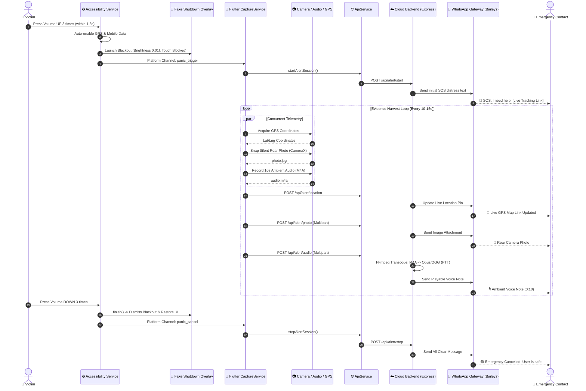

# 🛡️ Sentinel: Stealth Women & Personal Safety System

[](https://flutter.dev)
[](https://dart.dev)
[](https://kotlinlang.org)
[](https://nodejs.org)
[](https://expressjs.com)
[](https://github.com/WhiskeySockets/Baileys)
[](https://ffmpeg.org)
[](https://www.docker.com)
[](https://opensource.org/licenses/MIT)

> **Next-Generation Personal Safety and Emergency Distress System** engineered with low-level Android Accessibility hardware key interception, a stealth "Fake Shutdown" anti-tamper blackout overlay, continuous multi-modal background evidence harvesting (GPS, silent photos, ambient audio), and automated real-time dispatch to WhatsApp emergency contacts via a cloud-hosted backend.

---

## 📌 Table of Contents

- [Overview](#-overview)
- [The Problem with Existing Safety Apps](#-the-problem-with-existing-safety-apps)
- [Key Features](#-key-features)
- [System Architecture](#-system-architecture)
- [Execution & Operational Workflow](#-execution--operational-workflow)
- [Project Directory Structure](#-project-directory-structure)
- [Prerequisites](#-prerequisites)
- [Getting Started](#-getting-started)
  - [1. Mobile App Setup (Flutter + Android)](#1-mobile-app-setup-flutter--android)
  - [2. Backend Setup (Node.js + Express)](#2-backend-setup-nodejs--express)
  - [3. Linking WhatsApp via Web QR Dashboard](#3-linking-whatsapp-via-web-qr-dashboard)
- [Deployment Guide](#-deployment-guide)
  - [Deploy Backend to Render](#deploy-backend-to-render)
  - [Docker Container Build](#docker-container-build)
- [Hardware Permissions & Requirements](#-hardware-permissions--requirements)
- [Security & Anti-Tamper Design](#-security--anti-tamper-design)
- [Testing & Validation](#-testing--validation)
- [Contributing](#-contributing)
- [License](#-license)

---

## 🌟 Overview

During critical personal emergencies (assault, stalking, street harassment, kidnapping, or domestic intimidation), a victim **cannot** look at their screen, unlock their smartphone, browse icons, or press an on-screen SOS button without provoking immediate aggression from an attacker.

**Sentinel** solves this challenge by eliminating all visual and touch requirements:
1. **Pocket-Triggered**: The user presses the physical **Volume UP** key **3 times** (within 1.5 seconds) while the phone remains inside a pocket or purse.
2. **Stealth Lockdown ("Fake Shutdown")**: The smartphone display instantly turns pitch-black (`0.01f` brightness), blocks the notification shade and control center, hides the navigation bar, and swallows all touch events. To an assailant or bystander, the phone appears completely powered off or dead.
3. **Autonomous Sensory Sentinel**: In the background, the app auto-enables GPS and mobile data, captures silent rear-camera photos via CameraX, records ambient audio clips (M4A/AAC), and streams live GPS coordinates.
4. **Instant WhatsApp Emergency Delivery**: Evidence is transmitted to a cloud backend and broadcast directly to trusted contacts on WhatsApp—including live GPS tracking links, photo attachments, and FFmpeg-transcoded playable Opus voice notes.
5. **Covert Disarm**: The emergency state can only be safely cancelled by the owner pressing the physical **Volume DOWN** key **3 times**.

---

## ⚠️ The Problem with Existing Safety Apps

| Traditional Emergency Apps | Sentinel Stealth Safety System |
| :--- | :--- |
| ❌ Requires unlocking the phone and navigating a UI | ✅ **Zero-screen triggering** via physical Volume UP button (3x) |
| ❌ Emits loud sirens or flashing strobe lights that provoke assailants | ✅ **100% silent & stealthy**; screen mimics a dead/powered-off device |
| ❌ Sends plain SMS messages that suffer delivery delays | ✅ **Sub-second WhatsApp delivery** with interactive multimedia |
| ❌ Static coordinates with no contextual intelligence | ✅ **Multi-modal evidence**: Live moving GPS track, ambient audio, burst photos |
| ❌ Touchscreen accessible to attackers to disable GPS or app | ✅ **Full input lockout**: All touch events, back/home gestures swallowed |
| ❌ Audio recordings fail to play in WhatsApp on mobile | ✅ **Cloud FFmpeg transcoding**: Opus/OGG PTT voice notes play natively on Android & iOS |

---

## 🚀 Key Features

- **⚡ Hardware Key Accessibility Interception**
  - Utilizes Android's `AccessibilityService` (`VolumeAccessibilityService.kt`) with low-level key filtering (`canRequestFilterKeyEvents="true"`).
  - Intercepts raw volume button pulses at the OS kernel level, even when the device is locked, the screen is turned off, or another app is running.
  - Suppresses system volume sliders/HUD dialogs so button presses remain completely silent and invisible.

- **📴 Stealth Anti-Tamper Lockdown (Fake Shutdown Overlay)**
  - Launches a dedicated `FakeShutdownActivity.kt` on top of the window manager with screen brightness forced to `0.01f` (pitch black).
  - Immersive sticky mode hides status bars, navigation bars, and gesture pills.
  - Overrides `dispatchTouchEvent()` and `dispatchKeyEvent()` to consume all touches, back button presses, and home gestures.
  - Keeps CPU running continuously using an Android foreground service with a persistent partial `WakeLock`.

- **📡 Autonomous Telemetry Harvesting**
  - **GPS Tracking**: High-accuracy coordinates acquired via `Geolocator` and streamed to the cloud every 10–15 seconds.
  - **Silent Camera Capture**: `NativeCameraHelper.kt` binds directly to an off-screen `ImageReader` using CameraX/Camera2 APIs, snapping full-resolution JPEG frames without viewfinder previews or shutter noises.
  - **Ambient Audio Recording**: `NativeAudioHelper.kt` utilizes `MediaRecorder` targeting the `MPEG_4` container with `AAC` audio encoding at 44.1 kHz / 64 kbps.

- **💬 WhatsApp Gateway & Opus Transcoding**
  - Integrated with `@whiskeysockets/baileys` directly over encrypted WebSockets—no expensive per-message SMS fees or WhatsApp Business API template approvals.
  - **FFmpeg Transcoding Pipeline**: Cloud server transcodes uploaded M4A clips into `audio/ogg; codecs=opus` with the `ptt: true` push-to-talk flag, guaranteeing immediate native in-chat playback on both Android and iOS devices.

- **🗺️ Live Moving GPS Route Tracker**
  - Accessible via `/track/:sessionId` on any web browser.
  - Interactive Leaflet.js map with OpenStreetMap tiles displaying the victim's live route breadcrumbs, velocity, heading, and pulsing radar pin.
  - One-tap button to open live coordinates in Google Maps.

- **🔄 Safe Deactivation Protocol**
  - Triple-pressing **Volume DOWN** cleanly dismisses `FakeShutdownActivity`, restores original screen brightness, stops recording loops, and notifies emergency contacts that the user is safe.

---

## 🏗️ System Architecture

```
+-----------------------------------------------------------------------------------+
|                           1. HARDWARE INTERCEPTION TIER                           |
|  Physical Volume Rockers (UP x3 / DOWN x3) | Power Button | Battery State         |
+-----------------------------------------------------------------------------------+
                                         │ (Kernel KeyEvents)
                                         ▼
+-----------------------------------------------------------------------------------+
|                        2. NATIVE ANDROID SUBSYSTEM (Kotlin)                       |
|  • VolumeAccessibilityService: Intercepts keys at OS level without screen on      |
|  • FakeShutdownActivity: WindowManager pitch-black overlay, touches swallowed     |
|  • TriggerForegroundService: Prevents OS battery killer, holds CPU WakeLock       |
|  • NativeCameraHelper (CameraX): Background camera without preview surface        |
|  • NativeAudioHelper (MediaRecorder): Records high-fidelity M4A/AAC snippets      |
+-----------------------------------------------------------------------------------+
                                         │ (Platform MethodChannels)
                                         ▼
+-----------------------------------------------------------------------------------+
|                          3. FLUTTER ORCHESTRATION LAYER                           |
|  • CaptureService: State machine managing capture loops, sessions & retries       |
|  • ApiService: Multipart HTTP networking to the remote cloud server               |
|  • SettingsService: Persistent preferences (SharedPreferences)                    |
|  • LogService: In-memory & diagnostic logging for verification                    |
+-----------------------------------------------------------------------------------+
                                         │ (Encrypted HTTPS / REST API)
                                         ▼
+-----------------------------------------------------------------------------------+
|                    4. CLOUD INFRASTRUCTURE (Node.js / Render)                     |
|  • Express REST API: Manages alert sessions, handles multipart media uploads      |
|  • Live Tracking Engine: Serves responsive web interface with Leaflet maps        |
|  • WhatsApp Baileys Engine: Direct WebSocket link into the WhatsApp network       |
|  • FFmpeg Transcoder: Converts audio into Opus/OGG PTT voice notes                |
+-----------------------------------------------------------------------------------+
```

---

## 🔄 Execution & Operational Workflow



---

## 📂 Project Directory Structure

```
safety_app_v2/
├── android/                             # Android Native Kotlin & Gradle
│   ├── app/
│   │   ├── build.gradle                 # Android build config, CameraX & coroutines
│   │   └── src/main/
│   │       ├── AndroidManifest.xml      # Privileges, permissions, services
│   │       ├── kotlin/com/example/safetyapp/
│   │       │   ├── VolumeAccessibilityService.kt # Hardware key event filter
│   │       │   ├── FakeShutdownActivity.kt       # Pitch-black anti-tamper UI
│   │       │   ├── NativeCameraHelper.kt         # Silent off-screen CameraX
│   │       │   ├── NativeAudioHelper.kt          # Background MediaRecorder
│   │       │   ├── TriggerForegroundService.kt   # Persistent CPU WakeLock
│   │       │   ├── BatteryLevelReceiver.kt       # Low battery auto-trigger
│   │       │   ├── BootReceiver.kt               # Boot completed auto-start
│   │       │   ├── TriggerBridge.kt              # Platform MethodChannel bridge
│   │       │   └── MainActivity.kt               # Flutter engine lifecycle
│   │       └── res/                              # Drawables, mipmaps, XML configs
│   ├── build.gradle
│   └── settings.gradle
├── assets/                              # App icons and graphics
│   └── icon/
│       └── app_icon.png
├── backend/                             # Node.js / Express Cloud Server
│   ├── .baileys_auth/                   # Multi-device session auth (git-ignored)
│   ├── Dockerfile                       # Debian-slim container with FFmpeg
│   ├── package.json                     # Express, Baileys, FFmpeg dependencies
│   ├── server.js                        # REST API & Leaflet.js live tracking portal
│   ├── whatsapp.js                      # Baileys client & FFmpeg Opus transcoder
│   ├── RENDER_DEPLOY_GUIDE.md           # Step-by-step cloud deployment guide
│   └── uploads/                         # Temporary evidence buffer (.gitkeep)
├── lib/                                 # Flutter Application
│   ├── main.dart                        # App entry point & initialization
│   ├── screens/                         # UI Screens
│   │   ├── home_screen.dart             # Status dashboard, test alert
│   │   ├── contacts_screen.dart         # Emergency contact manager
│   │   ├── settings_screen.dart         # Backend URL, auto-blackout toggle
│   │   ├── logs_screen.dart             # Diagnostic event logs
│   │   ├── permissions_screen.dart      # Accessibility & sensor permission onboarding
│   │   └── splash_screen.dart           # App splash screen
│   ├── services/                        # Service Controllers
│   │   ├── capture_service.dart         # Orchestrates parallel harvest loops
│   │   ├── api_service.dart             # Multipart HTTP client
│   │   ├── settings_service.dart        # SharedPreferences persistence
│   │   ├── trigger_channel.dart         # MethodChannel communicator
│   │   ├── log_service.dart             # In-memory logging
│   │   └── theme_service.dart           # Dark/light theme management
│   └── theme/                           # Styling, color tokens
├── pubspec.yaml                         # Flutter dependencies & metadata
├── analysis_options.yaml                # Dart static analysis configuration
├── .gitignore                           # Multi-tier gitignore (Flutter, Android, Node)
└── README.md                            # Comprehensive project documentation
```

---

## 📋 Prerequisites

Before running or deploying the project, ensure you have the following installed:

- **Mobile Development**:
  - [Flutter SDK](https://flutter.dev/docs/get-started/install) `v3.19.0` or higher
  - [Dart SDK](https://dart.dev/get-dart) `v3.3.0` or higher
  - [Android Studio](https://developer.android.com/studio) / Android SDK (API Level 34)
  - Physical Android Device running **Android 8.0 (API 26) or higher** (Emulators cannot simulate physical volume rockers accurately).

- **Backend Development**:
  - [Node.js](https://nodejs.org) `v20.x LTS` or higher
  - [npm](https://www.npmjs.com/) `v10.x` or higher
  - [FFmpeg](https://ffmpeg.org/download.html) installed locally (if running backend outside Docker)
  - [Git](https://git-scm.com/)

---

## 🛠️ Getting Started

### 1. Mobile App Setup (Flutter + Android)

1. **Clone the Repository**:
   ```bash
   git clone https://github.com/<YOUR_USERNAME>/safety_app_v2.git
   cd safety_app_v2
   ```

2. **Install Flutter Dependencies**:
   ```bash
   flutter pub get
   ```

3. **Connect a Physical Android Device**:
   - Enable **Developer Options** and **USB Debugging** on your Android phone.
   - Verify connection:
     ```bash
     flutter devices
     ```

4. **Run the App in Debug / Profile Mode**:
   ```bash
   flutter run
   ```

5. **Build the Production APK**:
   ```bash
   flutter build apk --release
   ```
   The compiled APK will be generated at:
   `build/app/outputs/flutter-apk/app-release.apk`

6. **Grant Essential Android Permissions**:
   Upon opening the app:
   - Tap **Enable Accessibility Service** $\rightarrow$ Navigate to **Installed Apps / Accessibility** $\rightarrow$ Turn on **Personal Safety Sentinel**.
   - Grant **Camera**, **Microphone**, and **Location ("Allow all the time")** permissions.
   - In Settings, configure your **Trusted Emergency Contact WhatsApp numbers** (with country code, e.g., `+919876543210`).

---

### 2. Backend Setup (Node.js + Express)

1. **Navigate to Backend Directory**:
   ```bash
   cd backend
   ```

2. **Install Dependencies**:
   ```bash
   npm install
   ```

3. **Start the Local Development Server**:
   ```bash
   node server.js
   ```
   The server will start on: `http://localhost:3000`

---

### 3. Linking WhatsApp via Web QR Dashboard

1. Open your browser and navigate to:
   ```
   http://localhost:3000/qr
   ```
   *(or `https://<YOUR_RENDER_URL>/qr` in production)*

2. Open **WhatsApp** on your personal or dedicated alert phone:
   - Tap **Menu (⋮)** on Android or **Settings** on iOS.
   - Tap **Linked Devices** $\rightarrow$ **Link a Device**.
   - Scan the QR code displayed on the webpage.

3. Once connected, the server dashboard displays:
   `✅ WhatsApp is Connected & Ready`

---

## ☁️ Deployment Guide

### Deploy Backend to Render

1. Create a free account on [Render.com](https://render.com).
2. Click **New +** $\rightarrow$ Select **Web Service**.
3. Connect your GitHub repository.
4. Configure the service:
   - **Root Directory**: `backend`
   - **Environment**: `Docker` *(Recommended: automatically configures Debian with FFmpeg)*
   - **Instance Type**: `Free` or `Starter`
5. Click **Create Web Service**.
6. Once deployed, Render provides a public HTTPS URL (e.g., `https://safety-app-backend-xxxx.onrender.com`).
7. Open the mobile app $\rightarrow$ Go to **Settings** $\rightarrow$ Paste your Render URL $\rightarrow$ Save.

### Docker Container Build

Build and run the backend locally using Docker:

```bash
cd backend
docker build -t safety-backend .
docker run -p 3000:3000 -v $(pwd)/.baileys_auth:/app/.baileys_auth safety-backend
```

---

## 🔒 Hardware Permissions & Requirements

| Permission | Android API Level | Justification |
| :--- | :--- | :--- |
| `BIND_ACCESSIBILITY_SERVICE` | All APIs | Intercepts physical Volume UP & DOWN key events globally without waking the screen. |
| `SYSTEM_ALERT_WINDOW` | API 23+ | Draws the full-screen Fake Shutdown overlay over all windows and system bars. |
| `ACCESS_FINE_LOCATION` | All APIs | Tracks high-precision GPS coordinates during active distress alerts. |
| `ACCESS_BACKGROUND_LOCATION` | API 29+ | Allows location tracking while the device screen is off and in the pocket. |
| `CAMERA` | All APIs | Silent off-screen image captures via CameraX to record perpetrator/surroundings. |
| `RECORD_AUDIO` | All APIs | Records ambient conversations and background noises in M4A/AAC format. |
| `FOREGROUND_SERVICE` | API 28+ | Keeps the background harvest loops alive, preventing the OS battery optimizer from killing the app. |
| `WAKE_LOCK` | All APIs | Holds partial CPU wake lock to ensure uninterrupted network uploads. |

---

## 🛡️ Security & Anti-Tamper Design

1. **Anti-Attacker Deception**:
   - The fake shutdown overlay sets `window.attributes.screenBrightness = 0.01f`.
   - All navigation gestures (Back button, Home button, App Switcher) and status bar pulldowns (Notification shade, Quick Settings) are intercepted and consumed.
   - The attacker cannot turn off GPS, enable Airplane mode, or close the application.

2. **Data & Privacy Governance**:
   - Telemetry (GPS, microphone, camera) is **strictly dormant** during daily usage and activates **only** upon emergency verification.
   - Temporary captured evidence files stored in the local cache are automatically deleted once uploaded.

3. **WhatsApp Authentication Security**:
   - Session keys are saved locally in `.baileys_auth` and protected via `.gitignore` to prevent credential exposure.
   - Direct end-to-end socket communication with WhatsApp servers eliminates third-party SMS interception risks.

---

## 🧪 Testing & Validation

Run the following test scenarios to verify end-to-end functionality:

| # | Test Scenario | Steps | Expected Result |
| :-: | :--- | :--- | :--- |
| 1 | **Emergency Trigger** | Press Volume UP 3 times quickly (<1.5s) | Screen turns black; device locks touch; SOS alert arrives on WhatsApp. |
| 2 | **Input Lockdown** | Tap, swipe, or press Back while screen is black | Display remains pitch black; zero UI interaction allowed. |
| 3 | **Photo Delivery** | Wait 10 seconds during active emergency | Contact receives rear-camera JPEG snapshot on WhatsApp. |
| 4 | **Audio Voice Note** | Speak near the device during emergency | Contact receives playable WhatsApp voice note waveform. |
| 5 | **Live Map Tracking** | Open tracking link from WhatsApp message | Leaflet map displays real-time GPS marker and moving trail. |
| 6 | **Emergency Cancel** | Press Volume DOWN 3 times | Blackout screen dismisses; UI restored; All-Clear sent to WhatsApp. |

---

## 🤝 Contributing

Contributions, bug reports, and feature requests are welcome!

1. Fork the Project: `git checkout -b feature/AmazingFeature`
2. Commit your Changes: `git commit -m 'Add AmazingFeature'`
3. Push to the Branch: `git push origin feature/AmazingFeature`
4. Open a Pull Request

---

## 📄 License

Distributed under the **MIT License**. See `LICENSE` for more information.

---

<div align="center">
  <sub>Engineered for public safety, empowerment, and reliable emergency response.</sub>
</div>
